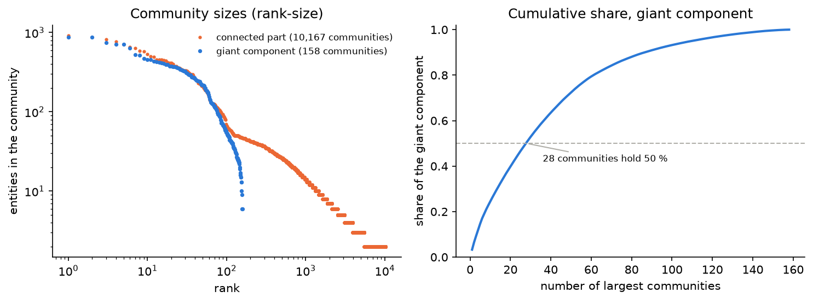
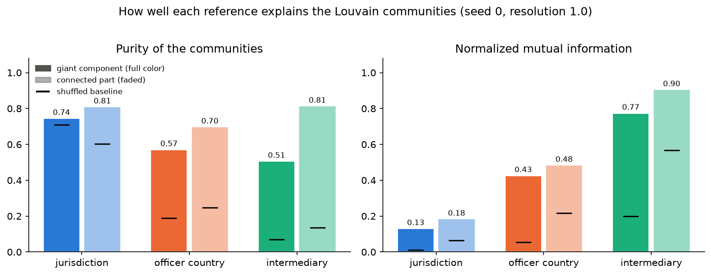

> DRAFT. Sections marked **[TODO]** wait for a teammate or for a final check. Replace this header with the Inside template before submission.

## 1. Introduction and question

The Panama Papers leak (2016) exposed the client files of the law firm Mossack Fonseca: thousands of offshore companies, the people behind them and the intermediaries that ordered them. The International Consortium of Investigative Journalists (ICIJ) published the structure as a graph.

**Question.** Who structures the offshore network of the Panama Papers? We identify the central intermediaries, officers and jurisdictions (degree, betweenness, PageRank), then check whether the communities found by Louvain follow the jurisdictions of the entities, the countries of the officers, or the intermediaries.

**Scope.** We work on the Panama Papers only. The brief also mentions Paradise and Pandora Papers. The Pandora Papers entities have no relationship in the ICIJ bulk file, so no Pandora graph can be built. A single leak keeps the graph coherent and computable, and comparing communities with the leak of origin is therefore out of scope.

## 2. Data

**Source.** ICIJ Offshore Leaks Database, bulk CSV (`full-oldb.LATEST.zip`, generated 2026-09-09), https://offshoreleaks.icij.org/pages/database, downloaded 2026-11-06. License: the database is under the Open Database License (ODbL 1.0) and its contents under Creative Commons Attribution-ShareAlike 3.0. ICIJ asks users to cite the International Consortium of Investigative Journalists.

**Structure.** The database is a graph stored in CSV files, one per node type plus one for links, joined on a unique `node_id`. The column `sourceID` gives the leak of origin and lets us keep the Panama Papers.

| Node type | Meaning | Count (Panama Papers) |
|---|---|---|
| Entity | Offshore company, trust or foundation | 213,634 |
| Officer | Person or company that owns, directs or fronts an entity (including nominees) | 238,402 |
| Intermediary | Law firm, bank or agent that ordered the structure | 14,110 |
| Address | Postal address | 93,454 |

Three relationship types connect an entity to the rest of the network: `officer_of` (309,363 links), `intermediary_of` (213,634) and `registered_address` (151,105). The other types in the database (`same_name_as`, `similar`...) are deduplication hints from ICIJ and are ignored. Most `registered_address` links go from an officer to an address (145,795 of 151,105), so addresses add little to the entity graph.

## 3. Graph model

**Bipartite graph.** Entities on one side, connectors (officers, intermediaries, entity addresses) on the other. A link says "this connector is attached to this entity". The graph is undirected, simple and unweighted: only the existence of a link matters for our questions, and the direction of the ICIJ links (connector to entity) carries no further information. It has 468,623 nodes and 511,687 edges.

**Entity projection.** Two entities are linked when they share a connector. The weight is the number of shared connectors. A connector attached to $d$ entities adds $d(d-1)/2$ edges, so the intermediary with 7,016 entities alone would add about 24.6 million edges. We cap the hubs in the projection: officers with more than 500 entities and intermediaries or addresses with more than 50 are ignored when linking entities. This gives 213,634 nodes and 1,238,967 weighted edges.

**Sensitivity of the intermediary cap.** We rebuilt the projection with intermediary caps of 10, 50 (our choice), 100 and 500.

| Intermediary cap | Edges | Isolated entities | Largest component |
|---|---|---|---|
| 10 | 857,671 | 153,511 (71.9 %) | 18,901 (8.8 %) |
| **50** | **1,238,967** | **129,607 (60.7 %)** | **26,643 (12.5 %)** |
| 100 | 2,060,376 | 111,417 (52.2 %) | 34,705 (16.2 %) |
| 500 | 9,524,444 | 66,675 (31.2 %) | 73,218 (34.3 %) |

A higher cap links more entities and grows the giant component, at the price of many more edges (7.7 times more at 500 than at 50) and of cliques created by a few big firms. The share of isolated entities stays between 31 % and 72 %, so the fragmentation of the projection is a property of the data and the cap only moves it. We keep 50 as a compromise between coverage and artificial cliques.

{width=85%}

**Choices that matter.**

- Centralities are computed on the bipartite graph, where intermediaries are nodes, and on the projection, where only entities are.
- Communities are computed on the projection.
- The cap removes the largest hubs from the projection. This lengthens distances and isolates entities that only share a hub connector.

## 4. Basic statistics and connectivity

| | Bipartite | Entity projection |
|---|---|---|
| Nodes | 468,623 | 213,634 |
| Edges | 511,687 | 1,238,967 |
| Density | 4.7e-6 | 5.4e-5 |
| Mean degree | 2.18 | 11.6 |
| Max degree | 7,016 | 720 |
| Connected components | 12,218 | 139,643 |
| Largest component | 310,904 (66.3 %) | 26,643 (12.5 %) |
| Isolated nodes | 0 | 129,607 |

{width=90%}

Degrees follow a heavy-tailed distribution: most nodes have one or two links and a few hubs have thousands. In the projection, 129,607 entities (61 %) are isolated: their connectors are shared by nobody, or exceed the cap. The bipartite graph has one giant component and 12,217 small ones.

{width=90%}

## 5. Diameter and radius

Distances are in hops, per connected component, since both graphs are disconnected. The diameter is the largest eccentricity and the radius the smallest.

- **Projection:** exact, with a breadth-first search from every node (scipy `csgraph`, 109 s for the largest component).
- **Bipartite giant component** (310,904 nodes): all-pairs is too heavy, so we report a lower bound on the diameter (20 double sweeps) and an upper bound on the radius (eccentricity of the midpoint of the longest path found).

| Graph | Component | Nodes | Diameter | Radius |
|---|---|---|---|---|
| Projection | 1st | 26,643 | 30 | 16 |
| Projection | 2nd to 5th | 115 to 132 | 5 to 9 | 3 to 5 |
| Bipartite | Giant | 310,904 | at least 37 | at most 20 |

{width=70%}

In the largest projection component, eccentricities are centered around 20 and reach 30, with 74 central nodes of eccentricity 16. A path of length 2 in the bipartite graph (entity, connector, entity) equals one hop in the projection, so the two sets of distances are not comparable directly.

## 6. Centralities

**[TODO: Jad to check this section against notebook 03.]** We compute degree centrality, PageRank (damping 0.85) and betweenness on the bipartite graph and on the projection. Betweenness is estimated by sampling sources (50 on the 311,000-node bipartite giant component, 200 on the projection component, seed 0), because exact betweenness needs a shortest-path tree from every node.

{width=95%}

**Intermediaries.** Orion House Services (HK) Limited is attached to 7,016 entities, followed by Mossack Fonseca & Co. (Panama, 4,364), Prime Corporate Solutions SARL (4,117), Offshore Business Consultant (Int'l) Limited (4,094) and Mossack Fonseca & Co. (Singapore, 3,888). The top 15 by degree and by PageRank are the same 15 names, and the rank correlation between the two scores over all intermediaries is 0.92. By betweenness, the Singapore and UK offices of Mossack Fonseca come first and Orion House third.

{width=80%}

**Officers.** Mossfon Subscribers Ltd. (Samoa) is attached to 3,882 entities, against 368 for the next officer. It is a nominee company, and in a bipartite graph every path between two entities goes through a connector, so this single node carries a large share of the shortest paths.

**Projection.** On the projection, rank correlations between degree, PageRank and betweenness are weak (Spearman 0.2 to 0.65), and none of the 20 most central entities of the bipartite graph appears in the top 20 of the projection. The two graphs answer different questions: the bipartite graph ranks the actors that hold the links, the projection ranks entities that sit between many others.

**Jurisdictions.** Jurisdictions are node attributes, not nodes. The British Virgin Islands hold 113,648 entities, Panama 48,360, the Bahamas 15,915 and the Seychelles 15,182. Among the 50 entities with the highest bipartite PageRank, 37 are in the British Virgin Islands.

{width=75%}

## 7. Communities

**Method.** Louvain (Blondel et al., 2008) maximizes the weighted modularity of the entity projection, with resolution 1.0. The 129,607 isolated entities cannot belong to any community and are excluded, which leaves 84,027 entities: one giant component of 26,643 entities and 10,035 small components of 2 to 132 entities. The giant component is the main result. A small component of two entities sharing one officer is trivially one pure community and would inflate every score.

**Stability.** Five seeds give 158 to 160 communities on the giant component, a modularity of 0.957 and a mean pairwise NMI of 0.98 between seeds. python-louvain gives 158 communities, modularity 0.957 and an NMI of 0.99 with the NetworkX partition.

**Shape.** The giant component splits into 158 communities, the largest with 875 entities and a median of 92. Twenty-eight communities hold half of the entities and 75 communities of at least 100 entities hold 86 %. A modularity of 0.957 describes dense blocks joined by few edges, which matches the diameter of 30. On the whole connected part, 10,034 of the 10,035 small components are exactly one community each.

{width=85%}

**Which reference explains the communities.** Each entity carries three labels: its jurisdiction, the most frequent country of its officers and its intermediary. We measure agreement with purity, inverse purity and normalized mutual information (NMI), against a baseline where the labels are shuffled over the entities. The baseline matters because the British Virgin Islands hold 71 % of the giant component, so a random partition already looks pure for the jurisdiction.

| Reference (giant component) | NMI | NMI of shuffled labels | Purity | Inverse purity |
|---|---|---|---|---|
| Intermediary | 0.77 | 0.20 | 0.51 | 0.79 |
| Country of the officers | 0.43 | 0.06 | 0.57 | 0.21 |
| Jurisdiction | 0.13 | 0.01 | 0.74 (baseline 0.71) | 0.07 |

{width=85%}

NMI ranks the intermediary first, the country of the officers second and the jurisdiction last. Jurisdiction purity sits only 0.04 above its shuffled baseline. Inverse purity shows that 79 % of the entities sit in the community where most of their intermediary's clients sit, against 21 % for the officer country and 7 % for the jurisdiction. The communities therefore follow the client books of the intermediaries and, to a lesser extent, groups of officers from the same country. The order holds at every resolution from 0.25 to 4. A community is usually larger than one intermediary: the dominant intermediary covers 51 % of its community on average, and the largest communities group several firms from the same place, such as Jersey trust companies or Panama law firms.

**Effect of the hub cap.** 65 % of the giant component's entities (17,278) have an intermediary above the cap of 50, so their intermediary created no edge. They still cluster by intermediary (NMI 0.80, purity 0.70), through the nominee officers and addresses that the clients of a big firm share. The cap removes the mechanical effect of a shared intermediary and the result remains.

**Conclusion.** The hypothesis holds: the communities of the Panama Papers network follow the intermediaries more than the officers' countries and far more than the jurisdictions.

## 8. Discussion and limits

- One leak only: no comparison across leaks, and the structure reflects one law firm's clients.
- Hub cap: a modeling choice that changes distances and isolates 61 % of entities in the projection (31 % to 72 % depending on the cap, section 3).
- Sampled betweenness: reliable at the top of the ranking only.
- Communities are computed on the 39 % of entities that are not isolated in the projection. The 61 % left out have no information to cluster on.
- The bulk file reflects ICIJ's own deduplication and a data cut-off in 2015.
- Names refer to companies and persons published by ICIJ. Presence in the leak does not imply wrongdoing.

## 9. Reproducibility, code and AI tools

- **Code:** Python 3.12, pandas, NetworkX 3.3, scipy, python-louvain, matplotlib. Repository: https://github.com/achillekrtf/offshore-graph (`src/` for the code, `notebooks/` for the analysis, README for the steps to reproduce). The raw data is not stored in the repository.
- **Reused code:** none beyond the libraries above. **[TODO: confirm with Jad and Adrian.]**
- **AI tools used and purpose:** Claude Code (Anthropic) helped to write the loading and graph-construction code, the diameter computation, the cap sensitivity test and notebooks 01 and 02, and to draft this report; every number was recomputed by a script and checked by the authors. **[TODO: each member lists their own tools, e.g. Cursor and Neo4j assistance for notebook 03 and the Neo4j dashboard, and for notebook 04.]**

## References

- International Consortium of Investigative Journalists (ICIJ), *Offshore Leaks Database*, https://offshoreleaks.icij.org.
- Hagberg, Schult, Swart, *Exploring network structure, dynamics, and function using NetworkX*, SciPy 2008.
- Blondel, Guillaume, Lambiotte, Lefebvre, *Fast unfolding of communities in large networks*, J. Stat. Mech., 2008.
- Brandes, *A faster algorithm for betweenness centrality*, J. Math. Sociol., 2001.
